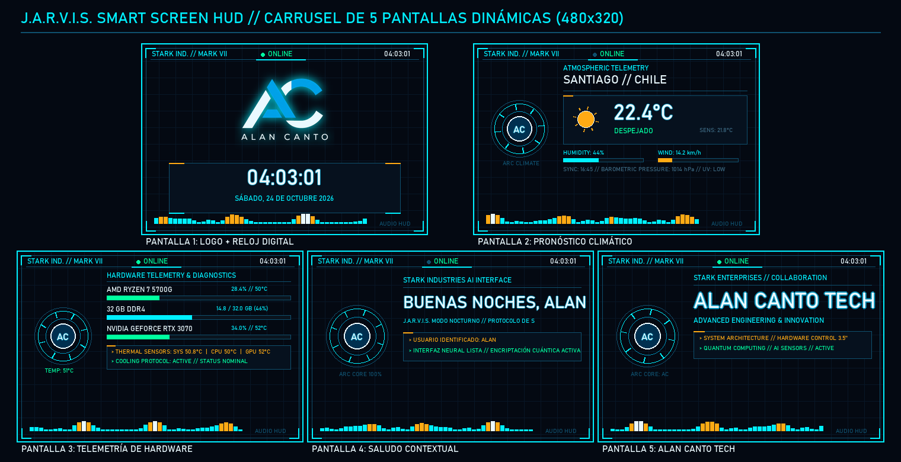
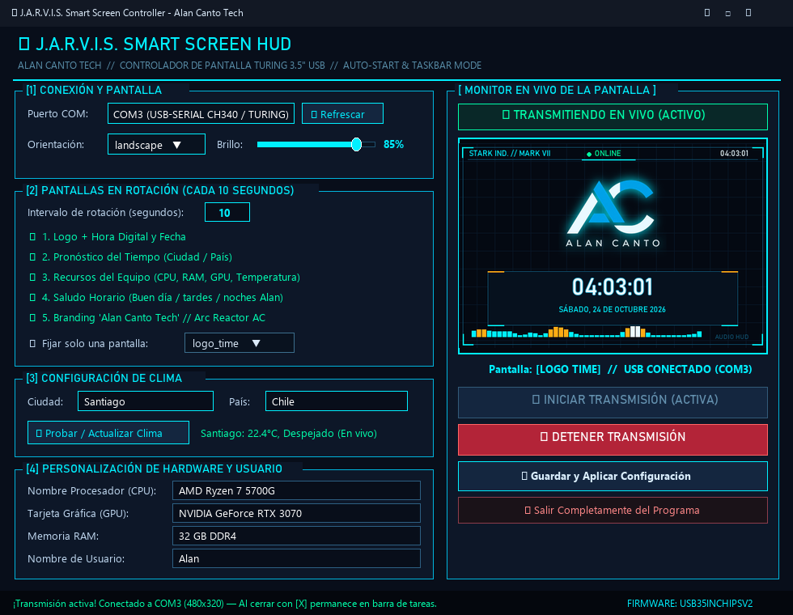
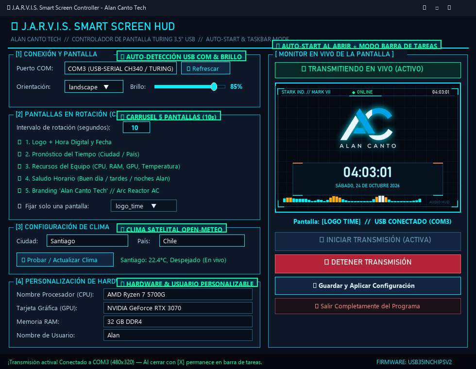
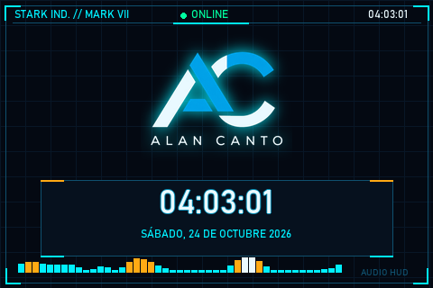
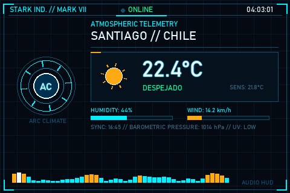
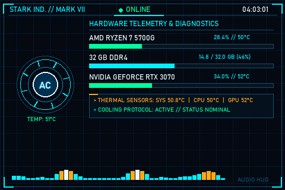
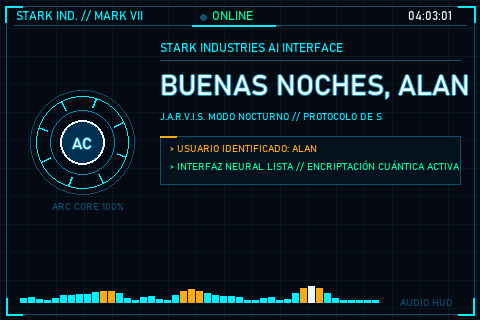
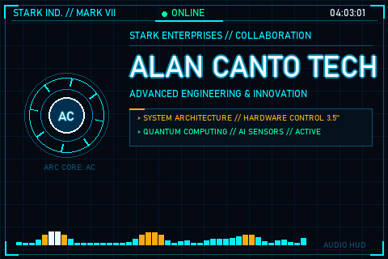
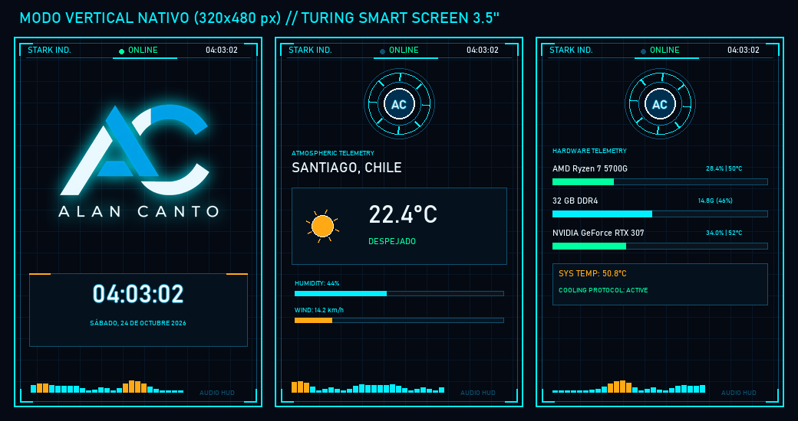
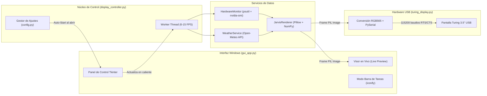

# ⚡ J.A.R.V.I.S. Smart Screen Controller — Alan Canto Tech

<p align="center">
  
</p>

<p align="center">
  <b>Sistema HUD Holográfico Estilo Stark Industries / J.A.R.V.I.S. para Pantallas Secundarias USB Turing Smart Screen (3.5" IPS)</b><br/>
  <i>Desarrollado por <b>Alan Canto Tech</b> — Empaquetado como ejecutable autónomo para Windows (<code>.exe</code>) con inicio automático de transmisión y modo residente en barra de tareas.</i>
</p>

---



---

## 📋 Tabla de Contenidos

1. [Descripción General del Proyecto](#-1-descripción-general-del-proyecto)
2. [Características Principales](#-2-características-principales)
3. [Interfaz Gráfica de Usuario (Windows GUI)](#-3-interfaz-gráfica-de-usuario-windows-gui)
   - [Inicio Automático de Transmisión (Auto-Start)](#31-inicio-automático-de-transmisión-auto-start)
   - [Permanencia en la Barra de Tareas al Cerrar](#32-permanencia-en-la-barra-de-tareas-al-cerrar)
   - [Guía Visual del Panel de Control](#33-guía-visual-del-panel-de-control)
4. [Galería Detallada de las 5 Pantallas HUD](#-4-galería-detallada-de-las-5-pantallas-hud)
   - [Pantalla 1: Logo Holográfico + Reloj Digital y Fecha](#41-pantalla-1-logo-holográfico--reloj-digital-y-fecha)
   - [Pantalla 2: Telemetría Climática en Tiempo Real](#42-pantalla-2-telemetría-climática-en-tiempo-real)
   - [Pantalla 3: Diagnóstico y Recursos del Equipo (Hardware)](#43-pantalla-3-diagnóstico-y-recursos-del-equipo-hardware)
   - [Pantalla 4: Saludo Contextual Inteligente J.A.R.V.I.S.](#44-pantalla-4-saludo-contextual-inteligente-jarvis)
   - [Pantalla 5: Branding Corporativo Alan Canto Tech](#45-pantalla-5-branding-corporativo-alan-canto-tech)
   - [Soporte Nativo de Orientación Vertical (320×480)](#46-soporte-nativo-de-orientación-vertical-320480)
5. [Arquitectura del Sistema y Flujo de Datos](#-5-arquitectura-del-sistema-y-flujo-de-datos)
6. [Protocolo Serie USB (RGB565 Little-Endian)](#-6-protocolo-serie-usb-rgb565-little-endian)
7. [Distribución y Uso del Ejecutable Único (`.exe`)](#-7-distribución-y-uso-del-ejecutable-único-exe)
8. [Instalación y Ejecución desde Código Fuente](#-8-instalación-y-ejecución-desde-código-fuente)
9. [Estructura de Archivos y Configuración (`config.json`)](#-9-estructura-de-archivos-y-configuración-configjson)
10. [Solución de Problemas Frecuentes (Troubleshooting)](#-10-solución-de-problemas-frecuentes-troubleshooting)

---

## 🚀 1. Descripción General del Proyecto

**J.A.R.V.I.S. Smart Screen Controller** es una suite de control gráfico y telemetría en tiempo real diseñada en Python para pantallas secundarias **Turing Smart Screen de 3.5 pulgadas (chip USB35INCHIPS / CH552 / CH340)**.

A diferencia de los programas genéricos que requieren plantillas estáticas pesadas, este sistema implementa un **motor de renderizado procedural propio (`JarvisRenderer`)** basado en **Pillow + NumPy** capaz de dibujar en vivo:
- El **Arc Reactor animado** con turbina giratoria y las iniciales **`AC`** en su núcleo central.
- Un **ecualizador de espectro de audio HUD** animado en la parte inferior de cada cuadro.
- **Cinco pantallas especializadas** en rotación automática (o modo pantalla fija) a 6–15 FPS mediante conversión matricial ultrarrápida a formato binario **RGB565 (16 bits por píxel)**.

---

## ✨ 2. Características Principales

| Característica | Descripción Técnica |
| :--- | :--- |
| **Ejecutable Único (`.exe`)** | Empaquetado con PyInstaller (`--onefile --windowed`) en `dist/JarvisScreenController.exe` con recursos e iconos embebidos (`sys._MEIPASS`). No requiere instalar Python en el equipo destino. |
| **Auto-Inicio de Transmisión** | Al abrir la aplicación, carga automáticamente los parámetros de `config.json` e **inicia la transmisión de inmediato** hacia la pantalla USB y el visor en vivo. |
| **Modo Residente en Barra de Tareas** | Al pulsar el botón `[X]` de cerrar ventana, **la aplicación no se cierra ni interrumpe la pantalla USB**: se minimiza y permanece activa en la barra de tareas de Windows. Incluye un botón dedicado para salir por completo cuando el usuario lo desee. |
| **Reconexión USB Inteligente** | Si la pantalla Turing se conecta después de abrir el programa o se desconecta temporalmente, el hilo controlador detecta y reconecta el puerto COM automáticamente cada 3 segundos. |
| **Telemetría de Hardware Real** | Lectura en vivo del uso de CPU y memoria RAM mediante `psutil`, y temperatura/carga de tarjetas gráficas NVIDIA mediante `nvidia-smi` sin ventanas emergentes. |
| **Clima Satelital Open-Meteo** | Geocodificación automática por **Ciudad y País** y consulta meteorológica en vivo (temperatura, sensación térmica, humedad, viento e iconos animados) sin necesidad de API Keys de pago. |

---

## 🖥️ 3. Interfaz Gráfica de Usuario (Windows GUI)

La aplicación cuenta con una interfaz gráfica nativa para Windows con estética oscura cian/azul estilo **Stark Industries Mark VII**:



### 3.1. Inicio Automático de Transmisión (Auto-Start)
Cuando abres `JarvisScreenController.exe` (o ejecutas `python main.py`):
1. El sistema lee instantáneamente el archivo `config.json`.
2. Restaura el puerto COM preferido (`auto` o un puerto específico como `COM3`), orientación, nivel de brillo, pantallas habilitadas, ciudad climática y nombres personalizados de hardware.
3. **Activa automáticamente la transmisión** a los 250 ms de iniciar la interfaz, mostrando el indicador verde **`● TRANSMITIENDO EN VIVO (ACTIVO)`**.

### 3.2. Permanencia en la Barra de Tareas al Cerrar
Para evitar que un cierre accidental de la ventana apague o congele la pantalla secundaria USB:
- **Botón `[X]` de la barra de título:** Intercepta el evento `WM_DELETE_WINDOW` y minimiza el programa a la **barra de tareas de Windows** (`iconify()`), manteniendo el hilo de renderizado y comunicación serie activo en segundo plano.
- **Botón `✖ Salir Completamente del Programa`:** Ubicado en la parte inferior derecha del panel de control, detiene de forma segura el puerto serie USB y cierra el proceso por completo.

### 3.3. Guía Visual del Panel de Control



1. **`[1] CONEXIÓN Y PANTALLA`:** Selección o autodetección del puerto serie COM (`USB35INCHIPS` / `VID:1A86 PID:5722`), selector de orientación (`landscape` 480×320 o `portrait` 320×480) y control deslizante de brillo en vivo (10% a 100%).
2. **`[2] PANTALLAS EN ROTACIÓN (CADA 10 SEGUNDOS)`:** Ajuste del intervalo de rotación en segundos (3 a 120 s), casillas para activar o desactivar cualquiera de las 5 pantallas al vuelo, y opción para **fijar una única pantalla** de forma permanente.
3. **`[3] CONFIGURACIÓN DE CLIMA`:** Campos de texto para **Ciudad** y **País** junto con el botón `⚡ Probar / Actualizar Clima` para verificar la respuesta satelital en tiempo real.
4. **`[4] PERSONALIZACIÓN DE HARDWARE Y USUARIO`:** Permite definir el nombre exacto de tu **Procesador (CPU)**, **Tarjeta Gráfica (GPU)**, **Memoria RAM** y **Nombre de Usuario** (para los saludos personalizados de J.A.R.V.I.S.).
5. **`[ MONITOR EN VIVO DE LA PANTALLA ]`:** Espejo en tiempo real de lo que se está enviando por el cable USB, indicador de estado de conexión y botones de control (`Iniciar Transmisión`, `Detener Transmisión`, `Guardar y Aplicar Configuración` y `Salir Completamente`).

---

## 🎨 4. Galería Detallada de las 5 Pantallas HUD

El motor gráfico `JarvisRenderer` genera 5 pantallas dinámicas con resolución nativa **480×320 px** (Horizontal) o **320×480 px** (Vertical):

### 4.1. Pantalla 1: Logo Holográfico + Reloj Digital y Fecha
Muestra el logotipo oficial de **Alan Canto Tech** (`Logo.png`) tratado dinámicamente con un filtro de alto contraste y resplandor gaussiano cian para destacar sobre el fondo oscuro HUD, acompañado en la parte inferior por un reloj digital de gran formato y la fecha completa en español.

<p align="center">
  
</p>

### 4.2. Pantalla 2: Telemetría Climática en Tiempo Real
Presenta el **Arc Reactor AC** a la izquierda y el panel `ATMOSPHERIC TELEMETRY` a la derecha con la ciudad y país configurados, icono meteorológico animado (sol giratorio, lluvia animada o nubosidad), temperatura actual en `°C`, sensación térmica y barras de progreso para humedad relativa (`%`) y velocidad del viento (`km/h`).

<p align="center">
  
</p>

### 4.3. Pantalla 3: Diagnóstico y Recursos del Equipo (Hardware)
Monitorea en vivo los recursos del PC mostrando barras de carga y temperaturas para **CPU**, **Memoria RAM** (GB usados / totales y porcentaje) y **GPU**, además de una tarjeta inferior de sensores térmicos combinados y estado del protocolo de refrigeración.

<p align="center">
  
</p>

### 4.4. Pantalla 4: Saludo Contextual Inteligente J.A.R.V.I.S.
Adapta el mensaje de bienvenida automáticamente según el tramo horario del sistema:
- **06:00 a 12:59:** `"BUEN DÍA, ALAN"` — *Protocolos matutinos*.
- **13:00 a 19:59:** `"BUENAS TARDES, ALAN"` — *Monitoreo activo y sistemas nominales*.
- **20:00 a 05:59:** `"BUENAS NOCHES, ALAN"` — *Modo nocturno / Protocolo de seguridad Mark VII*.

<p align="center">
  
</p>

### 4.5. Pantalla 5: Branding Corporativo Alan Canto Tech
Pantalla insignia de identidad tecnológica con tipografía de alto impacto, resplandor holográfico, el **Arc Reactor AC** a máxima potencia y estado de arquitectura de hardware.

<p align="center">
  
</p>

### 4.6. Soporte Nativo de Orientación Vertical (320×480)
Al cambiar la orientación a `portrait` desde la interfaz, el motor reorganiza automáticamente todos los paneles, tarjetas, fuentes y coordenadas para adaptarse al formato vertical de 320×480 píxeles:



---

## 🏗️ 5. Arquitectura del Sistema y Flujo de Datos

El proyecto sigue una arquitectura modular desacoplada donde la interfaz gráfica (`Tkinter`), el hilo de control (`DisplayController`), los servicios de telemetría (`HardwareMonitor`, `WeatherService`) y el driver serie (`TuringDisplay`) operan de forma asíncrona sin bloquear la ventana de Windows:



---

## 🔌 6. Protocolo Serie USB (RGB565 Little-Endian)

El módulo [`turing_display.py`](turing_display.py) se comunica directamente con el microcontrolador de la pantalla mediante paquetes de comando de **6 a 16 bytes**:

| Comando | Código Decimal | Descripción |
| :--- | :---: | :--- |
| `RESET` | `101` | Reinicia el controlador interno de la pantalla. |
| `CLEAR` | `102` | Limpia el buffer de video actual. |
| `SCREEN_OFF` / `SCREEN_ON` | `108` / `109` | Apaga o enciende la retroiluminación IPS. |
| `SET_BRIGHTNESS` | `110` | Ajusta el brillo invirtiendo la escala `0..100%` al rango PWM `255..0`. |
| `SET_ORIENTATION` | `121` | Configura la orientación (`0`=Portrait, `2`=Landscape) y dimensiones `W×H`. |
| `DISPLAY_BITMAP` | `197` | Empaqueta coordenadas `(x0, y0, x1, y1)` en 5 bytes + código `197`, seguido del flujo de píxeles en **RGB565 Little-Endian (`<u2`)**. |

---

## 📦 7. Distribución y Uso del Ejecutable Único (`.exe`)

El proyecto está empaquetado en **un único archivo ejecutable portable** ubicado en:

```text
dist/JarvisScreenController.exe
```

### ¿Cómo funciona la portabilidad en un solo archivo?
1. **Recursos integrados (`sys._MEIPASS`):** Tanto `Logo.png` como `app_icon.ico` viajan dentro del `.exe`. La función `get_resource_path()` en [`config.py`](config.py) detecta automáticamente si el programa corre como `.exe` o como script Python, permitiendo también colocar un `Logo.png` externo junto al `.exe` si deseas reemplazar el logo sin recompilar.
2. **Instalación de Acceso Directo en 1 Clic:** Ejecuta [`Instalar_App.bat`](Instalar_App.bat) para generar automáticamente el acceso directo **JARVIS Screen Controller** con su icono oficial en el Escritorio de Windows.
3. **Cómo recompilar el `.exe` único:**
   ```powershell
   python build_exe.py
   ```

---

## 🛠️ 8. Instalación y Ejecución desde Código Fuente

Si deseas ejecutar o modificar el proyecto desde Python (3.10+):

```powershell
# 1. Instalar dependencias
pip install -r requirements.txt

# 2. Iniciar la Interfaz Gráfica de Windows (inicia transmisión automáticamente)
python main.py

# 3. Opciones avanzadas por línea de comandos (Modo Consola)
python main.py --mode live --fps 8
python main.py --mode static --screen weather --preview
```

---

## 📂 9. Estructura de Archivos y Configuración (`config.json`)

```text
ACScreenTuring/
├── dist/
│   ├── JarvisScreenController.exe   # Ejecutable único portable para Windows
│   └── config.json                  # Configuración persistente junto al ejecutable
├── docs/
│   └── images/                      # Capturas de pantalla e infografías de la documentación
├── main.py                          # Punto de entrada principal (GUI y CLI)
├── gui_app.py                       # Interfaz gráfica de Windows (Auto-Start y Barra de Tareas)
├── display_controller.py            # Hilo controlador de rotación, preview y reconexión USB
├── jarvis_renderer.py               # Motor gráfico procedural J.A.R.V.I.S. HUD (5 pantallas)
├── turing_display.py                # Driver serie USB (Protocolo RGB565 USB35INCHIPS)
├── hardware_monitor.py              # Telemetría de CPU, RAM y GPU (psutil + nvidia-smi)
├── weather_service.py               # Cliente meteorológico Open-Meteo con caché inteligente
├── config.py                        # Gestión de config.json y rutas PyInstaller (sys._MEIPASS)
├── build_exe.py                     # Compilador automático a un único archivo .exe (--onefile)
├── Instalar_App.bat                 # Creador de acceso directo en el Escritorio
├── Logo.png                         # Logotipo oficial Alan Canto Tech
├── app_icon.ico                     # Icono multi-resolución de la aplicación Windows
└── requirements.txt                 # Dependencias del proyecto
```

### Ejemplo de `config.json`
```json
{
    "port": "auto",
    "orientation": "landscape",
    "brightness": 85,
    "fps": 6.0,
    "rotation_interval": 10,
    "active_screens": [
        "logo_time",
        "weather",
        "hardware",
        "greeting",
        "brand"
    ],
    "single_screen_mode": false,
    "selected_single_screen": "logo_time",
    "weather_city": "Santiago",
    "weather_country": "Chile",
    "cpu_name": "AMD Ryzen 7 5700G",
    "gpu_name": "NVIDIA GeForce RTX 3070",
    "ram_name": "32 GB DDR4",
    "user_name": "Alan"
}
```

---

## 🔧 10. Solución de Problemas Frecuentes (Troubleshooting)

- **La pantalla USB no es detectada en modo `auto`:**
  Verifica en el *Administrador de dispositivos de Windows → Puertos (COM y LPT)* que aparezca el dispositivo `USB-SERIAL CH340` o `USB35INCHIPS`. Puedes pulsar el botón **`🔄 Refrescar`** en la interfaz y seleccionar el puerto `COM` manualmente.
- **Cerré la ventana con la `[X]` y el programa sigue transmitiendo:**
  ¡Es el comportamiento diseñado! Al pulsar `[X]`, el programa se minimiza a la **barra de tareas de Windows** para no interrumpir la pantalla Turing. Si deseas cerrarlo por completo, haz clic en el botón **`✖ Salir Completamente del Programa`** dentro de la interfaz.
- **Quiero personalizar el logotipo en el `.exe`:**
  Coloca cualquier imagen llamada `Logo.png` (preferiblemente con fondo transparente PNG) en la misma carpeta donde se encuentre `JarvisScreenController.exe`; el programa priorizará automáticamente ese archivo sobre el logo interno.

---

<p align="center">
  Desarrollado con ⚡ por <b>Alan Canto Tech</b> — <i>Advanced Engineering & Innovation</i>
</p>
